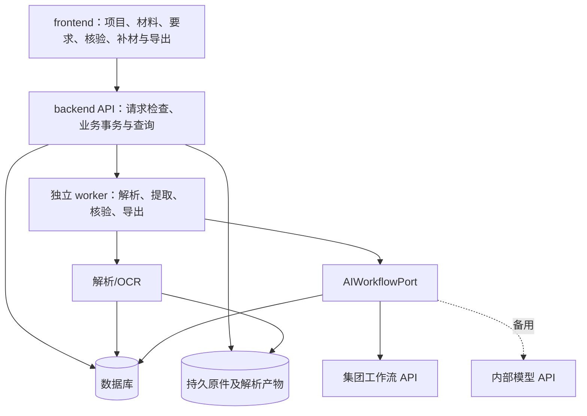

# 系统架构与目录规范

## 1. 技术基线

| 层 | 约定 |
|---|---|
| 前端 | React＋TypeScript＋Vite；组件优先 Ant Design，页面状态与请求逻辑分开 |
| 后端 | Python 3.11、FastAPI、Pydantic、SQLAlchemy、Alembic；同步数据库访问起步 |
| 本机数据库 | SQLite，API 与单 worker；事务短、受控并发 |
| 团队部署 | 有现成 PostgreSQL 时复用；迁移前跑相同存储和版本场景测试 |
| 存储 | LocalStorageAdapter 使用项目根目录 `var/storage/` 持久目录；保留替换对象存储接口 |
| 解析 | pdfplumber；pypdfium2 渲染；PaddleOCR 实际识别；LibreOffice 转换 DOC/DOCX |
| AI | mock / haier_workflow / internal_model，必须显式选择，不能静默回退 |
| 任务 | 数据库 jobs＋独立 worker；首版单 worker、单任务执行，前端轮询 |
| 测试 | pytest；前端单测按交互需要；关键浏览器端到端测试用 Playwright |

S01 选择上述组件相互兼容的版本，记录版本并提交锁文件。Node 建议使用仍受支持的 LTS，并按实际 Vite 最低要求核对。本次不预造依赖锁文件。

## 2. 组件关系



平台只接收已解析的有编号数据。前端不持有平台密钥，不直连模型、数据库或服务器文件路径。

## 3. 目录约定

以下为目标结构，除 README 和配置样例外需在 S01 以后创建：

```text
智标 AI/
  AGENTS.md
  README.md
  .env.example
  frontend/
    README.md
    package.json / package-lock.json
    src/
      app/              路由、布局、配置
      api/              请求客户端、类型、错误转换
      features/
        projects/ files/ requirements/ materials/ checks/ supplements/ exports/
      components/       原文预览、状态标签、任务进度等
    tests/
  backend/
    README.md
    pyproject.toml / uv.lock
    alembic.ini
    migrations/
    app/
      main.py
      settings.py
      api/              HTTP 层
      schemas/          API 和 AI 输入输出模型
      models/           ORM
      repositories/     数据查询与持久化
      services/         项目、版本、确认、重检、导出
      parsers/          PDF、图片、Word
      ocr/              OCR 接口与 Paddle 实现
      ai/               port、mock、平台和直接模型适配
      rules/            日期、数值、逻辑及引用检查
      tasks/            worker、claim、执行、恢复
      storage/          文件存取接口
    tests/
  var/                  运行数据，不提交版本库
  docs/
    README.md
    current/            最新开发基线与契约
    history/            整理说明及旧项目入口备份
    原有文件和目录       保留原位
```

业务代码不写入 docs 的历史示例目录。原 HTML Demo 只参考布局，不直接复制其模拟业务状态实现。

## 4. 启动与配置

根目录 `.env.example` 是配置字段约定；真实 `.env` 不提交。所有相对存储和 SQLite 路径以项目根目录解析，不依赖启动 cwd。

下列预期命令在 S01—S02 后逐步实现；本次文档整理后这些命令尚不可执行：

```text
cd backend
uv sync
uv run alembic upgrade head
uv run uvicorn app.main:app --reload --port 8000
uv run python -m app.tasks.worker

cd frontend
npm ci
npm run dev
```

worker 是单独终端/进程。API 前缀 `/api/v1`；前端默认 `http://localhost:5173`，后端 `http://localhost:8000`。前端配置只允许 API 基址等公开值。

## 5. 任务与故障

POST 长任务先落 jobs 后返回 202，携带 job_id。worker 通过事务条件更新领取 queued 任务，写入 heartbeat、进度、错误和输出。单 worker 仍使用领取条件以防重复执行。

首版重启策略：发现过期 running 任务后标记 interrupted，不自动重复文件替换或人工确认；通过幂等重试恢复。任务副作用按检查点执行并有 request key。

不能只依赖 FastAPI BackgroundTasks 或浏览器保持连接承担持久任务。首版不引入 Redis/Celery，但 jobs 的状态与重试必须真实持久。

重任务串行执行；PDFium 渲染若以后并发需遵守库的线程约束。模型并发和分页渲染批次按实际资源配置。

## 6. 业务边界

- API 层不写模型提示词；AI 适配不直接改确认或替换状态。
- OCR 输出事实文字与位置，AI 负责语义结构；二者均不能直接确认材料。
- services 负责事务、快照、幂等、当前版本与导出一致性。
- rules 不读取整个文件夹或调用模型；输入输出可独立测试。
- 上传目录只保存相对目录，不接受客户端绝对存储路径。服务器按 ID 定位文件。

## 7. 依据

- [FastAPI BackgroundTasks](https://fastapi.tiangolo.com/tutorial/background-tasks/)：理解进程内后台任务边界。
- [Vite 入门](https://vite.dev/guide/)：初始化及运行环境要求。
- [SQLAlchemy 版本检查](https://docs.sqlalchemy.org/en/20/orm/versioning.html)：理解过期写入；业务快照仍需自己实现。
- [Pydantic JSON Schema](https://docs.pydantic.dev/latest/concepts/json_schema/)：模型与契约生成和校验。
